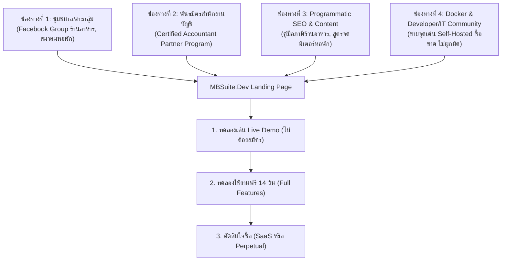

# ยุทธศาสตร์การตลาดและการเปลี่ยนผู้เข้าชมเป็นลูกค้า (Marketing & Conversion Strategy)
> บันทึก ณ วันที่: 2026-11-09  
> ผู้จัดทำ: อัล (พี่สี่) — สายงานระบบ/ผู้แทนพี่ฆัง  
> เป้าหมาย: กรอบยุทธศาสตร์การเข้าถึงตลาด (Go-To-Market), การสร้างยอดขาย และเป้าหมายการเติบโต

---

## 1. การวิเคราะห์กลุ่มลูกค้าเป้าหมายเชิงลึก (Customer Personas)

เพื่อให้การสื่อสารและการทำโฆษณาตรงเป้า เราแบ่งลูกค้าจริงออกเป็น 3 กลุ่มหลัก:

### Persona A: "เจ้าของร้านอาหาร / คาเฟ่ ยุคใหม่" (F&B / Retail Specialist)
- **พฤติกรรม:** ทำงานยุ่งหน้าร้านทุกวัน ปวดหัวกับพนักงานรับออเดอร์ผิด, โต๊ะเต็มแล้วจัดการไม่ทัน, สลิปโอนเงินปลอม, สต็อกวัตถุดิบไม่ตรง
- **Pain Point:** ไม่อยากใช้ระบบ ERP ซับซ้อน แต่อยากได้ระบบที่พนักงานกดใช้งานง่าย และลูกค้าสแกนสั่งเองได้
- **ข้อความที่โดนใจ:** *"ลูกค้าสแกนสั่งเอง ออเดอร์ตรงเข้าครัว เช็กบิลไว ป้องกันสลิปปลอมด้วย Dynamic PromptPay QR"*
- **แพ็กเกจที่เหมาะ:** **Single Suite (F&B)** 350 บ./เดือน หรือซื้อขาด 9,900 บ.

### Persona B: "เจ้าของหอพัก / อพาร์ตเมนต์ / คอนโดให้เช่า" (Rental Specialist)
- **พฤติกรรม:** สิ้นเดือนต้องเดินจดมิเตอร์น้ำไฟ นั่งกดเครื่องคิดเลขคำนวณเงิน แล้วเขียนใบเสร็จทีละห้อง มีปัญหาผู้เช่าจ่ายช้า
- **Pain Point:** ไม่อยากจ้างพนักงานบัญชีประจำ อยากได้โปรแกรมที่บันทึกเลขมิเตอร์แล้วคำนวณบิลค่าเช่าอัตโนมัติ
- **ข้อความที่โดนใจ:** *"จดมิเตอร์น้ำไฟเสร็จ ออกใบแจ้งหนี้ให้ผู้เช่าได้ทันที ไม่ต้องกดเครื่องคิดเลขซ้ำ เช็กสถานะการจ่ายเงินได้ในหน้าจอเดียว"*
- **แพ็กเกจที่เหมาะ:** **Single Suite (Rental)** 350 บ./เดือน หรือซื้อขาด 9,900 บ.

### Persona C: "เจ้าของกิจการ SME ที่จดทะเบียน VAT" (Complete Business Owner)
- **พฤติกรรม:** มีหน้าร้านหรือขายบริการ แต่ทุกสิ้นเดือนต้องรวบรวมใบเสร็จเอกสารส่งสำนักงานบัญชี เสียเวลากระทบยอด และกลัวสรรพากรเรียกตรวจ
- **Pain Point:** โปรแกรมบัญชีทั่วไปแพง (หลักหมื่นต่อปี) และแยกขาดจากหน้าร้าน ต้องคีย์ข้อมูลซ้ำซ้อนสองรอบ
- **ข้อความที่โดนใจ:** *"ขายหน้าร้านเสร็จ ตัวเลขวิ่งเข้าสมุดบัญชีและแบบภาษี ภ.พ.30 ทันที มี AI ตรวจสอบความถูกต้องให้ก่อนส่งสรรพากร"*
- **แพ็กเกจที่เหมาะ:** **Complete Bundle** 750 บ./เดือน หรือซื้อขาด 19,900 บ.

---

## 2. ช่องทางการตลาดและเข้าถึงลูกค้าต้นทุนต่ำ (Low-Cost Acquisition Channels)

เนื่องจากเราไม่ควรแข่งขันด้านงบยิงแอดขนาดใหญ่กับ FlowAccount หรือ PEAK เราจึงเน้นกลยุทธ์ **"กองโจรที่เจาะเฉพาะกลุ่ม (Niche Beachhead)"**:

1. **เจาะกลุ่ม Facebook Group เฉพาะทาง:**
   - โพสต์แชร์เคล็ดลับ "เทคนิคคิดค่าไฟหอพักตามเรทใหม่", "วิธีทำ KOT ครัวไม่ให้หลุดออเดอร์" พร้อมแนะนำเทมเพลตและระบบ MBSuite
2. **พันธมิตรสำนักงานบัญชี (Accountant Network):**
   - สำนักงานบัญชีมักรำคาญที่ลูกค้าส่งเอกสารกระดาษหรือ Excel มั่วมาให้
   - เสนอให้สำนักงานบัญชีแนะนำ MBSuite Core ให้ลูกค้าใช้ (สำนักงานบัญชีได้ค่าแนะนำ 20% หรือได้ใช้ Core ฟรีสำหรับดูแลบัญชีลูกค้า)
3. **การตลาดสาย IT / Self-Hosted (เจาะกลุ่มสายซื้อขาด):**
   - โปรโมทผ่านกลุ่มผู้ดูแลระบบ, กลุ่มผู้ใช้ Docker, กลุ่มคนทำโฮมเซิร์ฟเวอร์
   - ชูจุดเด่น: *"ERP/POS ที่คุณเป็นเจ้าของโค้ดและข้อมูล 100% ติดตั้งด้วย Docker จ่ายครั้งเดียวจบ"* กลุ่มนี้พร้อมจ่ายเงินก้อน 9,900 - 19,900 บาททันที

---

## 3. ยุทธศาสตร์กระตุ้นการเปลี่ยนเป็นลูกค้า (Conversion Funnel Optimization)

1. **ลดแรงต้านการทดลองใช้งาน (Frictionless Entry):**
   - *ปัญหาเดิม:* ให้กรอกฟอร์มสมัครก่อนถึงจะเห็นข้างใน ทำให้คนหลุดไปกว่า 70%
   - *วิธีแก้:* วางปุ่ม **"เปิด Live Demo"** ที่คลิกเดียวเข้าไปดูร้านตัวอย่างที่มีข้อมูลพร้อม กราฟพร้อม ให้ทดลองกดขายและออกบิลได้ทันที
2. **เครื่องคิดเลขคำนวณความคุ้มค่า (ROI Calculator บนเว็บ):**
   - ให้ลูกค้าเลื่อนแถบ: ปัจจุบันจ่ายค่าโปรแกรมเดือนละกี่บาท -> ระบบคำนวณให้เห็นว่าถ้าเปลี่ยนมาซื้อขาด MBSuite จะประหยัดเงินได้ปีละกี่หมื่นบาท
3. **ระบบสลับรับเงินที่สะดวกที่สุด (Frictionless Payment):**
   - ชำระเงินผ่านบัตรเครดิต (Stripe) สำหรับรายเดือน/รายปีแบบต่ออายุอัตโนมัติ
   - และรองรับการสแกน PromptPay สำหรับลูกค้าไทยที่สะดวกโอนเงินทันที

---

## 4. ตัวชี้วัดและเป้าหมายการเติบโต (Target Metrics)

- **เป้าหมายระยะสั้น (3 เดือนแรก):**
  - มีผู้ทดลองใช้งาน (Trials): 100 ธุรกิจ
  - อัตราการเปลี่ยนเป็นลูกค้าจริง (Trial-to-Paid Conversion): > 10% (อย่างน้อย 10 ลูกค้าจ่ายเงิน)
  - สัดส่วนยอดขาย: 70% Cloud Subscription, 30% Perpetual License (นำเงินก้อนมาหมุนเวียนพัฒนาต่อ)
- **จุดแข็งด้านการรักษาลูกค้า (Customer Retention / Churn Prevention):**
  - การผูกกับ Google Drive และ Google Sheets ทำให้ลูกค้ารู้สึกผูกพันกับข้อมูลเดิม ย้ายระบบยาก (High Switching Cost)
  - AI Auditor ช่วยแจ้งเตือนก่อนมีข้อผิดพลาด ช่วยสร้างความสบายใจให้ผู้ประกอบการ
