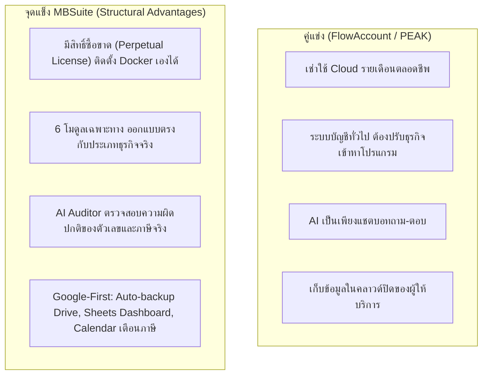

# แผนยุทธศาสตร์ โครงสร้างสถาปัตยกรรม และเป้าหมาย MBSuite (Strategy, Architecture & Goals)
> บันทึก ณ วันที่: 2026-11-09  
> ผู้บันทึก: อัล (พี่สี่) — สายงานระบบ/ผู้แทนพี่ฆัง  
> อ้างอิง: ข้อตกลงสถาปัตยกรรมและทิศทางธุรกิจร่วมกับพี่ฆัง

---

## 1. นิยามผลิตภัณฑ์และวิสัยทัศน์หลัก (Product Vision)

- **MBSuite (Micro-Business Suite):** ชุดซอฟต์แวร์บริหารธุรกิจและบัญชีอัจฉริยะสำหรับ SME และผู้ประกอบการรายย่อยในไทย พัฒนาโดย **Microtronic Co., Ltd.**
- **หลักการออกแบบ (Decoupled HQ-Branch Model):**
  - **Core (`Micro-Business-Suite`):** ทำหน้าที่เป็น **"สำนักงานใหญ่ (HQ)"** ดูแลการรวมยอดบัญชี (GL), การออกเอกสารทางการค้า (Quotation/Invoice/Receipt), ภาษีไทย (ภ.พ.30, ภ.ง.ด.53, RD-API ready), HR/เงินเดือน, และการสำรองข้อมูลอัตโนมัติบน Google Workspace
  - **6 Standalone Operational Suites:** ทำหน้าที่เป็น **"สาขา / จุดปฏิบัติการเฉพาะทาง"** รองรับ 6 ธุรกิจ:
    1. **F&B:** ร้านอาหาร, คาเฟ่ (โต๊ะ, QR สั่งอาหาร, KOT/ครัว, สต็อกวัตถุดิบ)
    2. **Retail:** ค้าปลีก, ร้านสะดวกซื้อ (สแกนบาร์โค้ด, ตะกร้าคิดเงิน POS, สต็อกหน้าร้าน)
    3. **Service:** ธุรกิจบริการ, ที่ปรึกษา, คลินิก (การจองคิว, นัดหมาย, สัญญาบริการ, ติดตามงาน)
    4. **Hotel:** โรงแรม, ที่พักรายวัน, เช่ารถ (การจองห้องพัก, Check-in/out, สถานะแม่บ้าน)
    5. **Rental:** หอพัก, คอนโด, อาคารให้เช่า (สัญญาเช่าระยะยาว, บิลค่าน้ำ-ไฟตามมิเตอร์)
    6. **Pharmacy:** ร้านขายยา (สต็อกแยกล็อต, วันหมดอายุ, แคตตาล็อกยา)

---

## 2. กฎบัตรสถาปัตยกรรมทางเทคนิค (Architectural Invariants & Decisions)

1. **ฐานข้อมูลเดียวแยก Prefix (Single Shared DB):**
   - ทั้ง 7 แอปพลิเคชัน (Core + 6 โมดูล) เชื่อมต่อ PostgreSQL ก้อนเดียวกัน (Neon สำหรับ Development / Supabase สำหรับ Production)
   - ข้อมูลของแต่ละแอปแยกขาดจากกันด้วย Table Prefix เฉพาะของโมดูล (`mbs_*`) ไม่มีการอ่าน/เขียนข้ามตารางของกันและกันโดยตรง
2. **การผสานระบบผ่าน Bridge API (Loose Coupling Integration):**
   - การส่งข้อมูลระหว่างโมดูลสาขาเข้าสู่ Core ทำผ่าน `/api/bridge/sync` ด้วย Authentication Token และมี Event Type ชัดเจน (เช่น `order.paid`, `payment.received`)
   - รองรับ Idempotency Key ป้องกันการบันทึกยอดซ้ำซ้อน และต้องไม่กระทบการทำงานหน้าร้านหากระบบ Core เกิดเหตุขัดข้อง
3. **การตัดระบบ Cross-Site SSO (No Shared SSO):**
   - ตัดความซับซ้อนของ SSO ข้ามโดเมนออกทั้งหมด แต่ละแอปพลิเคชันดูแลระบบ Authentication และ Session Cookie ภายในโดเมนของตนเอง
4. **ความปลอดภัยทางการเงิน (Financial Guardrails):**
   - ใช้ `Decimal(10, 2)` ในการคำนวณเงิน ห้ามใช้ IEEE 754 Float
   - ทำธุรกรรมการเงินและตัดสต็อกภายใต้ `prisma.$transaction`
   - ใช้ Soft-delete เสมอเพื่อรักษา Audit Trail ทางบัญชี

---

## 3. ตำแหน่งทางการตลาดและจุดขายเหนือคู่แข่ง (Market Positioning & Moats)

---

## 4. กลุ่มลูกค้าเป้าหมาย (Target Segments)

1. **SME รายย่อย / ร้านค้าเดี่ยว (Single Storefront):** ต้องการระบบที่เปิดใช้ได้ทันที ไม่ต้องตั้งค่าระบบบัญชีที่ซับซ้อน เลือกใช้ Single Suite (350 บ./ด. หรือซื้อขาด 9,900 บ.)
2. **ธุรกิจที่มีหน้าร้าน + ต้องยื่นภาษีจริง (Growing SME):** ต้องการระบบหน้าร้านที่เชื่อมเข้าสมุดบัญชีและภาษี ภ.พ.30 / ภ.ง.ด.53 ได้อัตโนมัติ เพื่อส่งให้นักบัญชีทุกสิ้นเดือน เลือกใช้ Complete Bundle (750 บ./ด. หรือซื้อขาด 19,900 บ.)
3. **ธุรกิจกลุ่ม Conservative / หวงแหนข้อมูล:** ไม่อยากจ่ายค่าเช่าระบบรายเดือนตลอดไป และต้องการเก็บฐานข้อมูลไว้บน Server ของตนเอง (กลุ่มเป้าหมายสำคัญของ Perpetual License)

---

## 5. แผนการนำเสนอผ่าน MBSuite.Dev

- หน้า Landing Page ต้องสะท้อน 3 แพ็กเกจราคาและสิทธิ์ Perpetual อย่างถูกต้อง (แก้ปัญหาข้อมูลราคาไม่ตรงกัน)
- ปรับปรุงเนื้อหาโบรชัวร์และศูนย์เอกสารให้เน้น 4 เสาหลัก: **"ตรงธุรกิจ - มีซื้อขาด - ฉลาดด้วย AI - อัตโนมัติกับ Google"**
- รองรับการทดลองใช้งาน 14 วันผ่าน Demo Data ที่พร้อมใช้งานทันที
